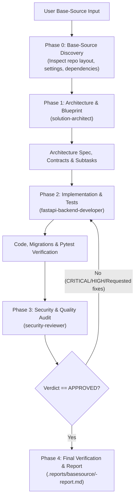

# Base-Source Development Workflow (`develop-basesource`)

This skill orchestrates the end-to-end lifecycle of turning a user's input into production-grade FastAPI backend source code, automated tests, security sign-off, and a summary report using three specialized subagents:

1. **`solution-architect`** — Designs the Clean Architecture blueprint, data model, API contracts, security-by-design controls, and sequenced engineering subtasks.
2. **`fastapi-backend-developer`** — Implements the source code across Clean Architecture layers, Alembic migrations, configuration templates, and `pytest` suites.
3. **`security-reviewer`** — Audits the source code and new features for OWASP API Top 10 vulnerabilities, auth/JWT/cookie flaws, injection, access control, and code quality.

---

## Orchestration Flow



---

## Detailed Phase Runbook

### Phase 0: Input Intake & Base-Source Discovery
1. Parse the user's input thoroughly:
   - Target capabilities, modules, or base-source enhancements (e.g., auth/RBAC, multi-tenancy, rate limiting, background tasks, audit logging, CRUD domain modules, hardening).
   - Constraints (sync vs async DB, PostgreSQL/SQLModel, Redis, Docker, external providers).
2. Inspect the current workspace baseline:
   - Read key project files (`README.md`, `requirements.txt`, `app/main.py`, `app/core/environment_setting.py`, `pytest.ini`, `tests/conftest.py`, and existing `app/` layers) so subagents work from verified ground truth.
3. If critical requirements are genuinely ambiguous (e.g., conflicting auth mechanisms or breaking schema choices), clarify with the user before designing; otherwise document explicit assumptions and proceed.

### Phase 1: Solution Architecture (`solution-architect`)
* **Subagent**: Invoke `solution-architect`.
* **Prompt Contents**:
  - The user's exact requirements and constraints.
  - Current repository layout, stack versions (`FastAPI`, `SQLModel`, `Alembic`, `Redis`, `PyJWT`, `pydantic-settings`), and any relevant existing files.
  - Instruction to produce:
    1. Clean Architecture layer mapping (`domain/`, `application/`, `infrastructure/`, `presentation/`, `core/`, `migrations/`, `tests/`).
    2. Data models, indexes, soft-delete rules, and Alembic migration plan.
    3. API endpoint contracts, Pydantic v2 schemas, pagination/filtering allow-lists, and `AppException` error model.
    4. Non-functional & security-by-design controls (auth, RBAC/ownership, secrets, caching, rate limits, logging).
    5. Ordered engineering subtasks with exact target files and `Given / When / Then` acceptance criteria.
* **Gate**: Review the architect's blueprint to ensure it respects inward Clean Architecture dependencies and covers all user requirements before starting implementation.

### Phase 2: Backend Implementation (`fastapi-backend-developer`)
* **Subagent**: Invoke `fastapi-backend-developer`.
* **Prompt Contents**:
  - The approved architecture blueprint and sequenced subtasks from `solution-architect`.
  - Explicit instructions to:
    1. Follow existing project conventions (`BaseRepository`, `BaseUseCase`, `AppException`, `Settings`, `APIRouter` under `/api/v1/`).
    2. Keep `app/.env.sample` updated for any new settings (placeholders only; never hardcode or commit secrets).
    3. Add or update Alembic migrations for any database schema changes.
    4. Write comprehensive `pytest` unit and integration tests under `tests/` covering happy paths, validation errors, and auth/permission edge cases.
    5. Run `pytest` and import/compile verification commands, reporting exact observed results and every file created or modified.
* **Note for Large Scopes**: If the blueprint spans many independent modules, split implementation into sequential or well-scoped subtask batches (using `send_message` to continue with the same `fastapi-backend-developer` conversation or separate scoped invocations).

### Phase 3: Security & Code Quality Audit (`security-reviewer`)
* **Subagent**: Invoke `security-reviewer`.
* **Prompt Contents**:
  - Scope of the audit: all newly created/modified files plus any touched security-sensitive boundaries (e.g., `auth_middleware.py`, `jwt_handler.py`, `dependencies.py`, `environment_setting.py`, `base_repository.py`, `exception_middleware.py`).
  - Request structured audit covering:
    - Auth, JWT algorithm/secret/claim separation, cookie flags, SSO state/CSRF.
    - BOLA/IDOR, BFLA/RBAC, middleware bypass paths.
    - SQL/ORM injection, dynamic `sort_by`/`getattr` safety, Pydantic validation, mass assignment, SSTI/SSRF.
    - Secrets hygiene, logging/stack-trace leakage, CORS, bounded pagination, Redis cache safety, Clean Architecture compliance, and test coverage.
* **Remediation Loop**:
  - If the verdict is `CHANGES REQUESTED` or `BLOCKED` (or any `CRITICAL`/`HIGH` findings remain), send the exact findings back to `fastapi-backend-developer` to remediate and re-run tests, then re-invoke `security-reviewer` (or message the existing reviewer with the updated diff) until the verdict is `APPROVED`.

### Phase 4: Final Verification & Report Generation
1. Confirm the full relevant `pytest` suite and application import/startup check pass **after the final edit** with zero unapproved skips or failures.
2. Save a development report to `.reports/basesource/<slug>-report.md` (creating `.reports/basesource/` if needed).
3. Summarize the completed architecture, changed files, test results, and security sign-off concisely for the user.

---

## Standard Base-Source Report Template

```markdown
# Base-Source Development Report: [Title]

- **Date**: [YYYY-MM-DD]
- **Status**: Completed & Security Approved
- **Agents Involved**: `solution-architect`, `fastapi-backend-developer`, `security-reviewer`

## 1. Input & Architectural Summary
[Concise summary of user input, architectural decisions (ADRs), and layer layout]

## 2. Subtasks Completed
- [x] **SUBTASK-1**: ...
- [x] **SUBTASK-2**: ...

## 3. Files Added or Modified
| File Path | Layer | Action | Description |
| :--- | :--- | :--- | :--- |
| `app/...` | Domain / Application / Infrastructure / Presentation | Added / Modified | ... |

## 4. Security Audit Sign-off
- **Reviewer Verdict**: `APPROVED`
- **Risk Posture**: [LOW | MEDIUM]
- **Key Controls Verified**:
  - [x] Authentication, JWT & cookie flags verified
  - [x] Authorization (BOLA/BFLA) & bypass paths verified
  - [x] Input validation, mass assignment & query allow-lists verified
  - [x] Secrets, logging & error leakage hygiene verified

## 5. Verification Results
- **Test Command**: `pytest ...`
- **Observed Outcome**: [Exact counts / pass status]
```
